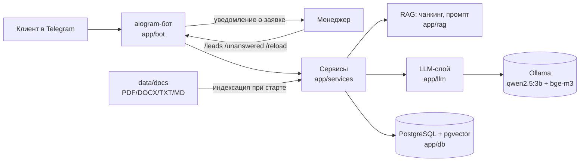

# AI-консультант для бизнеса


**Telegram-бот, который отвечает клиентам компании строго по её документам — и честно говорит «не знаю», если ответа там нет.**

Работает полностью локально: LLM и эмбеддинги крутятся в Docker через Ollama, никаких платных API и ключей.

<!-- TODO: GIF диалога с ботом -->


## Какую проблему решает

Малый бизнес (автосервис, клиника, салон) тратит часы на одни и те же вопросы: «сколько стоит», «когда работаете», «какая гарантия».
Обычный чат-бот на LLM для этого опасен — он **выдумывает** цены и условия.

Этот бот:
- даёт кнопочное меню (💰 цены по разделам, 📍 адрес и график, 🛡 гарантия, ❓ FAQ) — мгновенно, без LLM, текст берётся из тех же документов;
- на свободные вопросы отвечает **только** по загруженным документам (прайс, FAQ, условия) и показывает источник;
- если ответа нет — не фантазирует, а предлагает оставить заявку менеджеру;
- собирает заявки (имя + телефон) и сразу присылает их менеджеру в Telegram;
- **онлайн-запись**: услуга → день → свободное время → имя и телефон; двойная запись на одно время исключена на уровне БД;
- копит вопросы без ответа — видно, какие документы стоит дополнить;
- для менеджера: `/leads`, `/bookings` (ближайшие записи), `/stats` (вопросы, % с ответом, заявки, записи, топ услуг), `/unanswered`, `/reload`.

Демо-кейс: выдуманный автосервис «Мотор» в Тамбове (документы в `data/docs`).

## Архитектура



**Как отвечает на вопрос (RAG):**
1. Вопрос → вектор (модель `bge-m3`).
2. pgvector находит 5 самых похожих кусков документов.
3. Если похожесть ниже порога — LLM не вызывается вообще, бот говорит «не знаю» и предлагает заявку.
4. Иначе `qwen2.5:3b` получает куски + вопрос и инструкцию «отвечай только по ним». Если и она не нашла ответа — тоже «не знаю».

## Стек

Python 3.12 · aiogram 3 · PostgreSQL 16 + pgvector · SQLAlchemy 2.0 (async) · Alembic · Ollama (qwen2.5:3b, bge-m3) · Docker Compose · pytest

## Как запустить

Нужен только [Docker Desktop](https://www.docker.com/products/docker-desktop/).

```bash
cp .env.example .env    # впишите TELEGRAM_BOT_TOKEN (@BotFather) и MANAGER_CHAT_ID (@userinfobot)
docker compose up --build
```

При первом запуске автоматически скачаются модели (~3 ГБ, один раз), применятся миграции и проиндексируются документы из `data/docs`. Когда в логах появится `Бот запущен` — пишите боту.

**Без Docker** (если на машине нет WSL/виртуализации): установите [Ollama](https://ollama.com), скачайте модели `ollama pull qwen2.5:3b && ollama pull bge-m3`, затем
`pip install -r requirements.txt pgserver && python scripts/run_local.py` — поднимется встроенный PostgreSQL с pgvector.

Свои документы: положите файлы в `data/docs` и отправьте боту `/reload` (из чата менеджера).

Тесты:
```bash
docker compose run --rm bot pytest
```

## Структура

```
app/
  bot/        # хендлеры клиента, FSM заявки, команды менеджера
  rag/        # чтение файлов, чанкинг, промпт
  llm/        # интерфейсы Embedder/LLM, Ollama и Fake-реализации
  db/         # модели, репозитории (весь SQL здесь)
  services/   # индексация, ответ на вопрос, заявки
migrations/   # Alembic
data/docs/    # документы компании
tests/        # чанкинг, поиск, заявки, запись, статистика — без сети и БД
.github/      # CI: ruff, тесты, миграции на Postgres+pgvector, сборка Docker-образа
```

## Ключевые решения

- **Слои.** Бот вызывает только сервисы, сервисы — репозитории и LLM через интерфейсы (`Protocol`). Поэтому логику можно тестировать с in-memory заглушками, а провайдера LLM сменить, не трогая бизнес-логику.
- **Меню из документов.** Кнопки разбирают `price.md`/`faq.md`/`conditions.txt` (`app/services/catalog.py`): поменял цену в файле → `/reload` → меню обновилось. Один источник правды для кнопок и для RAG.
- **Двойная защита от галлюцинаций:** порог похожести до вызова LLM + маркер `НЕТ_ОТВЕТА` в ответе модели.
- **Запись без гонок.** Свободные слоты считаются по графику из FAQ, но окончательную защиту даёт частичный уникальный индекс `bookings(starts_at) WHERE status = 'active'`: если два клиента одновременно нажмут одно время, второй получит «время только что заняли». Проверка в коде — для удобства, индекс — для гарантии.
- **Журнал вопросов.** Каждый свободный вопрос пишется с флагом `answered` — из него строятся `/unanswered` и `/stats`.
- **CI.** GitHub Actions: `ruff check` + `ruff format --check`, тесты, миграции `upgrade → downgrade → upgrade` на настоящем pgvector, сборка Docker-образа.
- **Инкрементальная индексация:** по SHA-256 файла — неизменённые документы не пересчитываются при перезапуске.
- **Локальные модели:** `qwen2.5:3b` — лучший баланс «качество русского / скорость на CPU»; `bge-m3` — мультиязычные эмбеддинги, хорошо понимает русский.

## Как я разрабатывал с Claude Code

<!-- Дополните своими словами: что делали сами и чему научились -->
- **ТЗ и правила.** Я написал ТЗ (стек, функции, требования к качеству, ограничение «без платных API»). Claude Code сначала составил `CLAUDE.md` — описание проекта, структуру и правила слоёв, — и план по этапам; дальше работали по нему.
- **Итерации.** Код, тесты и демо-документы генерировались по этапам; после каждого я проверял бота руками в Telegram и просил объяснить ключевые решения (RAG, pgvector, FSM в aiogram, порог похожести).
- **Реальные проблемы по ходу.** Docker Desktop не встал: WSL не включался на моей Windows (DISM, ошибка 50), а кириллица в имени пользователя ломала пути системных утилит и `initdb`. Вместе с Claude Code нашли причину по логам DISM и сделали запасной режим `scripts/run_local.py` — встроенный Postgres с pgvector (pgserver) + Ollama для Windows.
- **Качество ответов.** На живых моделях проверили вопросы «в тему» и «мимо» (погода, ремонт трактора) — бот честно отвечает «не знаю». По результатам доработали промпт, чтобы модель не теряла важные оговорки (гарантия 14 дней на запчасти клиента).
- **UX.** По моему запросу добавили кнопочное меню: типовые вопросы закрываются мгновенно, LLM — только для свободных.
- **Развитие.** Добавили онлайн-запись на время, `/stats` для менеджера и CI на GitHub Actions; гонку при записи закрыли уникальным индексом и проверили на реальном Postgres.
- **Ограничение железа.** На ноутбуке с 8 ГБ RAM модель выгружается из памяти через минуту простоя (`keep_alive`).
